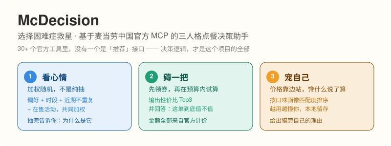

# McDecision · The "What Should I Eat" Solver

An entry for the **McDonald's × WorkBuddy Developer Innovation Challenge 2026**.
Built on McDonald's China official MCP, it uses three "eating personas" to decide what you should eat today.

[中文版 README](./README.md)



## One-liner

Others build a tool shell. This one builds a **decision engine** — and the heart of a decision engine is explainable decision rules.

## Why this exists

McDonald's MCP exposes 30+ tools for querying and transacting, but **not a single one is a "recommend" endpoint**.
Most entries wrap those tools in a shell and still end up doing "look up the menu / calculate the price / count calories".
The real pain point sits one step earlier: *it's noon, you're staring at the ordering page, and you have no idea what to eat.*

So this project does not compete on tool coverage. It translates a vague mental state into computable weights and constraints,
and commits to three things: **decisions are explainable**, **constraints come first**, and **it learns you over time**.

## Three modes

| Mode | For who | What it does |
|---|---|---|
| **Mood** | the go-with-the-flow me | Weighted random over preference + daypart + recent-repeat avoidance + active promos. Not a coin flip — and it tells you why that item won. |
| **Deal** | the bargain-hunting me | Claims coupons first, then runs combo trials inside your budget, returns Top 3 by value, and answers "is this order actually worth it". |
| **Treat** | the I-deserve-it me | Ranks by taste-profile match. Price steps aside for craving. Gives you a reason to indulge. |

One rule binds all three: **every recommendation must state its reason.** No black boxes.

## Quick start

### 1. Get an MCP token

- Open https://open.mcd.cn/mcp
- Sign in with your McDonald's account (SMS code)
- Top-right **Console** → **Activate** → copy the token

### 2. Mount the MCP

Copy `mcp-config.example.json` to `mcp-config.json`, replace `${MCD_MCP_TOKEN}` with your real token, then paste and enable it in
WorkBuddy → sidebar → **Connectors** → **Custom connector** → **Configure MCP**.

```bash
# Only needed if you use the script path
export MCD_MCP_TOKEN="your-token"
```

### 3. Install the skill

Drop the whole `mcd-decision/` folder into your WorkBuddy skills directory (e.g. `~/.workbuddy/skills/mcd-decision/`).

### 4. Run it

```bash
python3 scripts/mcd_client.py tools/list
python3 scripts/mcd_client.py now-time-info '{}'
python3 scripts/mcd_client.py query-nearby-stores '{"beType":1,"searchType":2,"city":"Dongguan","keyword":"Dongguan"}'
python3 scripts/mcd_client.py query-meals '{"storeCode":"1421187","orderType":1,"beType":1}'
python3 scripts/mcd_client.py auto-bind-coupons '{}'
```

### 5. Natural-language triggers

- "What should I eat at McDonald's today"
- "Deal mode, what's the best value under 30 yuan"
- "Treat mode, I want something nice"
- "No idea what to eat for lunch"

## A real run (Dongguan, store 1421187)

Queried at 21:48 against a real 24-hour restaurant. Prices below are actual `currentPrice` / `originalPrice` values
returned by the official menu endpoint — nothing is estimated.

**Deal mode, budget 30 yuan** — the engine ranks combos by how much they actually save:

| Item | Now | Was | You save |
|---|---:|---:|---:|
| 大堡口福三件套 | ¥22.9 | ¥47.5 | **¥24.6** |
| 龙焰鸡腿堡三件套 | ¥26.9 | ¥48.0 | ¥21.1 |
| 吉士汉堡包套餐 | ¥26.5 | ¥39.5 | ¥13.0 |
| 麦香鸡套餐 | ¥27.5 | ¥40.5 | ¥13.0 |

It picks 大堡口福三件套 — not because it is the cheapest, but because it has the highest discount rate among everything
that fits the budget, and it says so.

**Treat mode** — ignores price entirely and ranks by how well each item matches your taste profile.

**Mood mode** — weights your history, the current daypart (late-night menu 17:14–21:45, midnight menu 22:14–23:59)
and what you have not eaten lately, then explains the pick.

## Layout

```
mcd-decision/
├── SKILL.md                  # skill entry (loaded by the agent at runtime)
├── README.md                 # Chinese readme
├── README_EN.md              # this file
├── MCP_INTEGRATION.md        # MCP integration notes (required by the contest)
├── CONTEST_DECLARATION.md    # contest declaration (required, must not be altered)
├── mcp-config.example.json   # sanitized MCP config (placeholder only)
├── workbuddy.md              # WorkBuddy dev context (bonus-track proof)
├── .gitignore
└── scripts/
    └── mcd_client.py         # generic MCP client, stdlib only
```

## Design principle

> Querying goes to MCP. Arithmetic goes to code. Wording goes to the agent. **Decision rules stay here.**

- **Querying** — all data comes from the official MCP. No scraping.
- **Arithmetic** — every amount is produced by `calculate-price` (÷100). The model never does mental math.
- **Wording** — the agent turns results into human sentences.
- **Decisions** — the weights, constraints and matching logic behind the three modes are the actual differentiator.

## Known limits

- McDonald's China mainland only.
- Token rate limit is 600 requests/minute; exceeding it returns 429.
- Coupon product codes and menu product codes are two separate namespaces and must not be mixed.
- The taste profile lives in a local file and does not sync across devices.

## Security and compliance

- The token travels only through environment variables: never stored, never sent elsewhere, never printed, never committed.
- `mcp-config.json` and `preferences.json` are listed in `.gitignore`.
- The taste profile stays in local `preferences.json` and is never uploaded.
- This is an independent contest entry, not an official McDonald's product. Item info, prices and availability follow
  the official channel's live results.

## Disclaimer

Output is for reference only and is not medical, nutritional or other professional advice.
